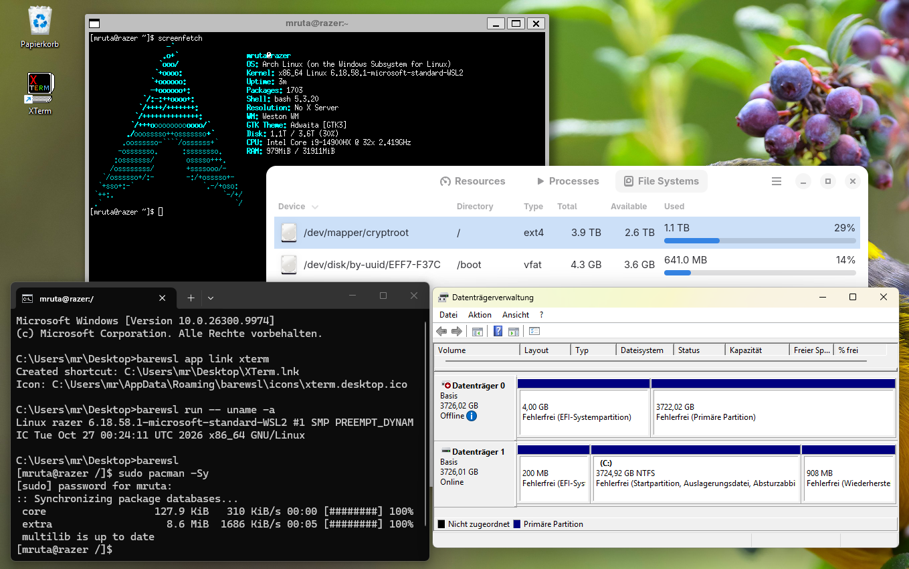

For years I have been using a dual boot. Windows for games, Linux for work. The annoying part is
when you need a file from the system you are not currently booted into. Rebooting just for that
interrupts whatever you were doing. And when I work on something on the Windows side, for example
[a World of Warcraft addon](/it/2026/02/10/deltachess-chess-in-world-of-warcraft.html), I want the
development setup I am used to, not a second incomplete one.

I used virtual machines for a while and booted the second disk in a VM. They use too much RAM and
CPU, and the integration between the two systems is not really seamless. Accessing the Windows
disks from Linux is fine. VeraCrypt and the NTFS support in the kernel are enough for that. The
other way around I never had a good option. There is no Windows driver with LUKS support, so
the filesystem behind the encryption stays unreachable.

## Attaching the disk to WSL

At some point this came up again. I searched around and asked ChatGPT. There had to be a way to
read those files from Windows. What I found is that you can attach a separate physical disk to a
WSL2 VM:

```
wsl --mount \\.\PHYSICALDRIVE1 --bare
```

The disk number is the one from `Get-Disk` in PowerShell. `--bare` gives the disk to the WSL
distribution as a block device, without Windows mounting the partitions itself. From there it is
normal Linux. `cryptsetup` can open the LUKS volume, and then you mount the filesystem as usual.
I tried it on my dual boot disk. It worked without problems.

## Using the installation, not just the files

Once that worked I wanted more than file access. If the whole root filesystem is mounted, I can
bind-mount `/dev`, `/proc` and `/sys` from the WSL distribution onto it and chroot in. Then I am
working in my actual Linux installation. Same home directory, same packages, same config. Almost
as if I had booted it. I tested that, and it worked too.

A shell was already useful. Then I thought: wait, is it even possible to start GUI applications
from here?

WSL on Windows 11 includes WSLg. A small system distribution runs a Wayland compositor, and an X
server in front of it, and the application windows show up on the Windows desktop. Programs inside
WSL talk to sockets that already exist in the distribution: Wayland under `/mnt/wslg`, X11 under
`/tmp/.X11-unix`. `WAYLAND_DISPLAY`, `DISPLAY` and `XDG_RUNTIME_DIR` point at them. A chroot has
its own `/mnt` and `/tmp`, so those sockets are not visible there. I bind-mounted them into the
chroot, set the variables, and started a program. The window opened on the Windows desktop.

So now I had my dual boot installation running from WSL, and it felt pretty close to using it
natively. What was left was the amount of stuff I had to run to get there:

- from an elevated Windows prompt, `wsl --mount \\.\PHYSICALDRIVE<N> --bare`
- in the WSL distribution, unlock LUKS with `cryptsetup` (and activate LVM, if the install uses it)
- mount the root filesystem and the other mounts the install expects
- bind-mount `/dev`, `/proc`, `/sys` and `/run`
- bind-mount `/mnt/wslg` and `/tmp/.X11-unix`
- copy a working `resolv.conf`, otherwise DNS inside the chroot is broken
- `chroot`, then switch to my user with the display variables set

Doing that by hand every time is tedious, and if you skip something the shell comes up half
broken. I wrote a script that did the sequence. Mounting and opening a shell worked. Starting a
GUI application from the script did not feel right. The terminal I started it from stayed open in
the foreground for as long as the application was running. Close the terminal and the application
goes away with it. A shortcut was just a batch file with a console attached to it.

The more I fiddled around with this, the clearer it became that I need access to native Windows
APIs to make the experience actually good. Hiding that console, creating real shortcuts, things a
shell script simply cannot do. So I started a small tool for it:
[barewsl](https://github.com/Deltachaos/barewsl).

## barewsl

barewsl is a single Windows program. The disk layout goes into a YAML file: which physical disk,
how to unlock it (LUKS, LVM, or both), which filesystems to mount, including Btrfs subvolumes, and
which paths from the WSL distribution should be bind-mounted into the Linux tree. It still needs
a WSL2 distribution, but only as the host that can see the disk. The shell and the programs run
from the mounted installation.

On a run it attaches the disk if it is not attached yet. That part needs administrator rights, so
Windows shows the UAC prompt. A small helper inside the WSL distribution then does the unlock and
the mounts. After that barewsl enters the installation with `chroot`, or with `systemd-nspawn` if
you set that in the config, and runs a shell or a command as your user. The mounts stay in place.
The next call skips the steps that are already done.

`barewsl --no-console run` starts a GUI program with the Windows console hidden. `barewsl app`
reads the `.desktop` files of the Linux installation, and `barewsl app link` creates Windows
shortcuts for them, with the icons. Those shortcuts call barewsl again. So the programs from the
Linux install can be started from the Start Menu, and no terminal window stays open while they
run.



Is it perfect? No. But it is better than everything I had before.

The big open issue is systemd. Starting systemd services inside the chroot is not possible, and
with `systemd-nspawn` I ran into problems with GUI applications. Maybe I will have a look at that
at some point and try to find a solution. Or you can, if you want. Until then this is one step
closer to a seamless workflow.
